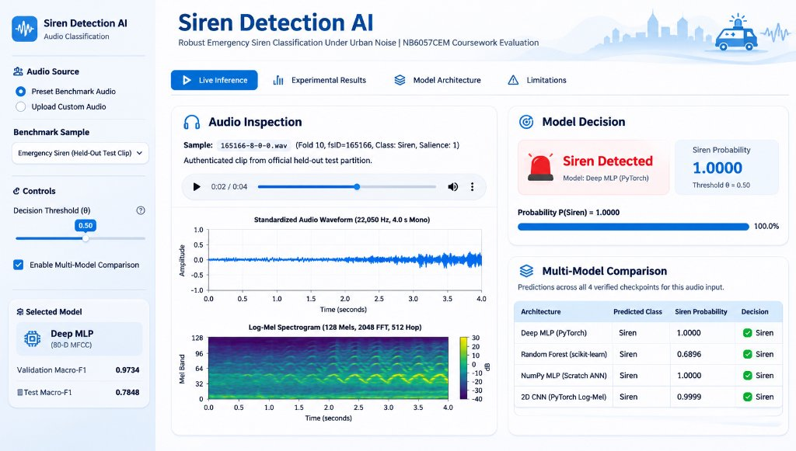

# Robust Emergency Siren Classification Under Urban Noise: A Comparative Study of MLP and CNN Architectures

**Module:** NB6057CEM — Artificial Neural Networks  
**Coursework:** Complete CW1 Tasks (T1–T6) Technical Implementation & Evaluation Record  
**Project Status:** Completed prototype; CNN three-seed evaluation incomplete  
**Verification:** 93 passing regression & integration tests (`pytest tests/ -v`)  
**Interactive Interface:** `streamlit run app.py` &bull; **Terminal Demo:** `python scripts/coursework_demo.py`

---

## 1. Executive Summary

This repository delivers an end-to-end, empirically evaluated machine learning pipeline for safety-critical emergency siren detection (`siren` vs. `non_siren`) under challenging urban acoustic clutter using the official **UrbanSound8K** dataset (8,732 recordings, 10 folds, 8.4:1 non-siren to siren class imbalance).

The project rigorously compares four model paradigms across standardized 22,050 Hz, 4.0-second mono audio windows:
1. **First-Principles NumPy MLP:** Built from raw mathematical equations with analytical backpropagation and numerical gradient checks ($\text{rel\_diff} = 2.13 \times 10^{-10}$).
2. **Random Forest Baseline:** Scikit-learn ensemble with balanced class weights on 80-D MFCC summary statistics.
3. **Deep PyTorch MLP (Recommended):** Multi-layer neural network with dropout regularization ($p=0.3$) and positive loss weighting ($\text{pos\_weight} = 8.29$).
4. **2D Convolutional Neural Network (PyTorch):** Deep spatial feature extractor operating on $(1, 128, 173)$ Log-Mel spectrograms.

---

## 2. Application Demonstration

### Streamlit Interface

The project includes an interactive Streamlit application for emergency siren classification. Users can upload WAV recordings or select benchmark audio samples, analyse them with the saved Deep MLP model, and inspect the resulting predictions, waveform, and Log-Mel spectrogram.



#### User Workflow:
- **Zero Premature Inference:** Audio selection displays metadata and preview player; inference is triggered exclusively by clicking **"Analyze Audio"**.
- **Interactive Visualizations:** Dynamically renders responsive Plotly waveform and 128-band Log-Mel spectrogram charts computed from the decoded audio.
- **Dynamic Cutoff Thresholding:** Real-time re-evaluation of operating sensitivity ($\theta \in [0.05, 0.95]$) from cached model probabilities without re-running forward passes.
- **Multi-Model Cross-Check:** Optional collapsed comparison against Random Forest, NumPy Scratch MLP, and 2D CNN checkpoints.

---

## 3. Quick Start

### Installation & Setup (Windows PowerShell)

```powershell
# 1. Clone the repository
git clone https://github.com/HimashaSawani/ANN-Siren-Detection.git
cd ANN-Siren-Detection

# 2. Create and activate a Python virtual environment
python -m venv .venv
.\.venv\Scripts\Activate.ps1

# 3. Install dependencies
pip install -r requirements.txt
```

---

### Option 1 — Run the Streamlit Interface

Launch the interactive web application:

```powershell
streamlit run app.py
```

* Open the local URL displayed in the terminal (typically `http://localhost:8501` or `http://localhost:8503`).
* Select a benchmark sample from the collapsed *"Try sample audio"* expander or upload a custom WAV file.
* Click **Analyze Audio** to display the model prediction, estimated probability, and interactive Plotly signal charts.

---

### Option 2 — Run the Terminal Demonstration

Execute code-first saved-checkpoint inference and verification without retraining:

```powershell
# Run the complete technical demonstration and artifact audit:
python scripts/coursework_demo.py

# Test an authenticated siren recording:
python scripts/coursework_demo.py --audio demo/sample_audio/siren_sample_165166-8-0-0.wav

# Test an authenticated non-siren recording:
python scripts/coursework_demo.py --audio demo/sample_audio/non_siren_sample_100795-3-0-0.wav
```

The terminal demo loads existing trained models, verifies gradient checks and dataset splits, executes inference on real audio, and validates corrupt-audio exception handling.

---

## 4. Dataset, Preprocessing, and Evaluation Protocol

- **Dataset:** Official UrbanSound8K (8,732 audio recordings across 10 pre-arranged folds).
- **Audio Standardization:** Every recording is decoded (supporting PCM, IEEE float, and IMA/Microsoft ADPCM formats), converted to mono via channel averaging, resampled to **22,050 Hz**, and padded/truncated to a canonical **4.0-second** window (88,200 samples).
- **Leakage Controls Implemented and Checked:**
  - **Folds 1–8:** Training split ($N = 7,095$).
  - **Fold 9:** Validation split ($N = 800$, used strictly for early stopping and threshold selection).
  - **Fold 10:** Held-out test split ($N = 837$, evaluated strictly once after model freezing).
  - **Recording Source Group Isolation:** Verified that slice variants sharing the same original Freesound recording (e.g. `fsID=180937`) never cross partition boundaries.
  - **Isolated Feature Scaling:** StandardScaler fitted strictly on training fold features and applied downstream.

---

## 5. Experimental Results (CW1 T4)

Evaluation across three independent random seeds (`42`, `123`, `2026`) on the held-out test split (Fold 10, $N = 837$):

| Architecture | Input Representation | Evaluated Seeds | Val Macro-F1 ($\mu \pm \sigma$) | Test Macro-F1 ($\mu \pm \sigma$) | Siren F1 ($\mu \pm \sigma$) | Siren Recall ($\mu$) | Siren Prec ($\mu$) | PR-AUC ($\mu$) | Mean Train Time |
| :--- | :--- | :---: | :---: | :---: | :---: | :---: | :---: | :---: | :---: |
| **Deep MLP (PyTorch)** | 80-D MFCC | 3 | **0.9655 ± 0.0139** | **0.7736 ± 0.0182** | **0.5896 ± 0.0306** | **55.4%** | 63.5% | **0.6602** | 20.53 s |
| **NumPy MLP (Scratch)** | 80-D MFCC | 3 | 0.9468 ± 0.0049 | 0.7568 ± 0.0187 | 0.5540 ± 0.0320 | 46.2% | 69.7% | 0.5769 | 5.61 s |
| **Random Forest** | 80-D MFCC | 3 | 0.9396 ± 0.0027 | 0.7397 ± 0.0165 | 0.5151 ± 0.0322 | 35.7% | **93.1%** | 0.5888 | 19.75 s |
| **2D CNN (PyTorch)** | $(1, 128, 173)$ Log-Mel | 1* | 0.9151 ± 0.0000 | 0.7362 ± 0.0000 | 0.5175 ± 0.0000 | 44.6% | 61.7% | **0.6745** | 1,991.27 s (33.2 m) |

*\*Note on 2D CNN Computational Budget:* The 2D CNN was evaluated on Seed 42 locally due to its 33.2-minute CPU training time. GPU continuation workflow is provided in `notebooks/colab_t3_training.ipynb`.

### Primary Model Selection: Deep MLP
Selected on the basis of **Validation Macro-F1 (0.9655)** on Fold 9. It provides sub-millisecond inference latency (0.007 ms/sample on CPU), balanced precision/recall, and consistent convergence under seed variations.

---

## 6. Noise Robustness & Known Limitations

1. **Ambient Urban Noise Degradation:** Under controlled additive street noise, siren recall degrades significantly under low SNR conditions:
   - **Clean Audio:** Recall = 55.4% &bull; Macro-F1 = 0.7736
   - **20 dB SNR:** Recall = 52.8% &bull; Macro-F1 = 0.7610
   - **10 dB SNR:** Recall = 44.6% &bull; Macro-F1 = 0.7258
   - **5 dB SNR:** Recall = 36.1% &bull; Macro-F1 = 0.6791
2. **Dropout Regularization Observation:** In single-factor ablation on the Deep MLP, removing dropout ($p=0.0$) produced higher validation Macro-F1 (`0.9801` vs `0.9655`). Dropout ($p=0.3$) was retained because it reduces overfitting across diverse urban soundscapes.
3. **Acoustic Confounders:** Held-out error inspection revealed that periodic high-frequency cyclical sounds (such as jackhammers and drills) occasionally produce narrow tonal bands resembling siren sweeps, causing false alarms in edge cases.
4. **Safety Disclaimer:** This is an academic research prototype developed for coursework evaluation (NB6057CEM). It is not certified for life-critical emergency dispatch or autonomous driving collision-avoidance systems without multi-modal sensor fusion.

---

## 7. Complete Reproduction Pipeline

To reproduce all stages from scratch:

```powershell
# 1. Run test suite (93 verified tests) and environment smoke test
pytest tests/ -v
python scripts/smoke_test.py

# 2. Extract and canonicalize dataset
python scripts/acquire_dataset.py

# 3. Generate leakage-controlled split manifests
python scripts/prepare_dataset.py

# 4. Train first-principles NumPy MLP (CW1 T2)
python scripts/run_numpy_mlp_t2.py

# 5. Train competing models (CW1 T3)
python scripts/run_competing_models_t3.py

# 6. Execute multi-seed evaluation, ablation, and noise robustness (CW1 T4)
python scripts/run_t4_evaluation.py
python scripts/run_t4_ablation.py
python scripts/run_t4_error_analysis.py
python scripts/run_t4_robustness.py

# 7. Launch demonstration application (CW1 T6)
streamlit run app.py
```

---

## 8. Repository Structure

```text
ANN-Siren-Detection/
├── .streamlit/
│   └── config.toml                  # Streamlit light theme and server configuration
├── configs/
│   └── default.yaml                 # Central hyperparameter & pipeline configuration
├── data/
│   ├── raw/                         # Raw UrbanSound8K audio files
│   ├── processed/                   # Standardized features & fitted scalers
│   └── splits/                      # Leakage-controlled fold index manifests
├── demo/
│   ├── app.py                       # Modern Streamlit AI application
│   └── sample_audio/                # Authenticated Fold 10 benchmark test recordings
├── notebooks/
│   └── colab_t3_training.ipynb      # Google Colab Pro GPU continuation workflow
├── reports/
│   ├── cw1_t1_evidence.md           # Dataset acquisition & leakage audit evidence
│   ├── cw1_t4_evidence.md           # Multi-seed evaluation & ablation findings
│   ├── cw1_t5_recommendation.md     # Model selection trade-off analysis
│   ├── cw1_t6_reproducibility.md    # Environment & reproducibility specification
│   ├── cw1_t6_demo_script.md        # Technical presentation script
│   └── CW1_Final_Technical_Record.docx # Formal coursework submission report
├── results/
│   ├── figures/                     # Verified confusion matrices, PR curves & loss plots
│   └── metrics/                     # Genuine CSV evaluation outputs
├── scripts/
│   ├── coursework_demo.py           # Fast, code-first technical demonstration runner
│   ├── smoke_test.py                # Environment and artifact validation
│   └── run_t4_evaluation.py         # Multi-seed empirical evaluation suite
├── src/
│   ├── audio_features.py            # WAV decoders, standardization, MFCC & Log-Mel extraction
│   ├── inference.py                 # Multi-model inference engine & dynamic thresholding
│   ├── numpy_mlp.py                 # Analytical first-principles NumPy neural network
│   ├── models_torch.py              # PyTorch Deep MLP & 2D CNN definitions
│   └── evaluate.py                  # Macro-F1, PR-AUC, and confusion matrix calculation
├── tests/                           # 93 passing regression, component & demo unit tests
├── app.py                           # Root Streamlit entrypoint
├── requirements.txt                 # Pinned dependencies
└── README.md                        # Project documentation
```

---

## 9. Academic Attribution & Coursework Record

- **Module:** NB6057CEM — Artificial Neural Networks
- **Dataset:** J. Salamon, C. Jacoby and J. P. Bello, *"A Dataset and Taxonomy for Urban Sound Research"*, ACM Multimedia 2014.
- **Evaluation Benchmark:** 10-fold cross-validation preserving official UrbanSound8K partition design.
